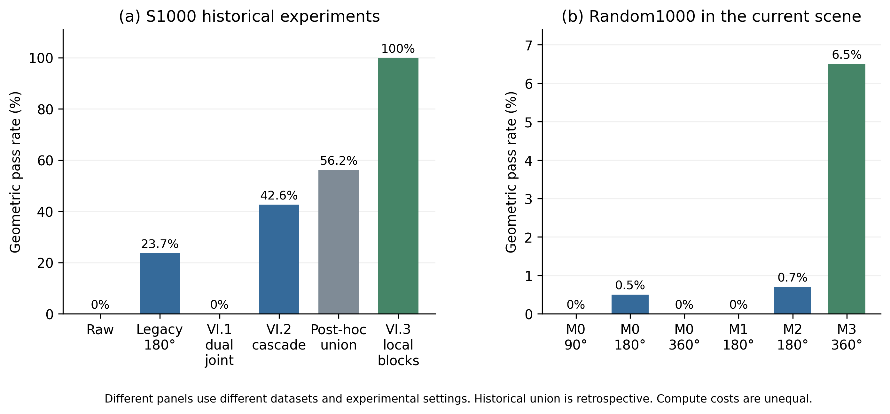

# SinoGermanRobot Paper Data

[中文说明](README_ZH.md) · [Data scope](DATA_SCOPE.md) · [Citation](CITATION.cff) · [License](LICENSE)

Research records supporting the manuscript **面向VLA数据准备的工业机械臂可视化建模与碰撞引导轨迹修正** by **任皓琛 and 刘春平**. Version **v1.0.0**, release date **2026-10-28**.

The collection contains trajectory inputs, offline geometric checks, failed and successful candidates, small engineering comparisons, and a limited set of previously recorded hardware outcomes. It is **not a training-ready VLA dataset**: synchronized multimodal episodes and VLA training results are not supplied.

## Download the data

The Git repository contains documentation, selected small CSV/XLSX tables and integrity indexes. **The full datasets are distributed as release ZIP assets.** A directory link below opens its guide and selected tables; it does not mean every raw-data path is present in the Git checkout. GitHub's automatic “Source code” archive likewise contains the repository checkout, not the complete data bundles.

- [Release v1.0.0](https://github.com/Learn-to-innovate-and-Surpass/SinoGermanRobot-PaperData/releases/tag/v1.0.0)
- [All seven packages in one ZIP](https://github.com/Learn-to-innovate-and-Surpass/SinoGermanRobot-PaperData/releases/download/v1.0.0/SinoGermanRobot-PaperData_v1.0.0_all.zip)
- [Package index](PACKAGE_INDEX.csv) and [archive SHA-256 checksums](https://github.com/Learn-to-innovate-and-Surpass/SinoGermanRobot-PaperData/releases/download/v1.0.0/SHA256SUMS)

| Package guide and selected tables | Research coverage | Complete package |
| --- | --- | --- |
| [01_RandomBaseline](01_RandomBaseline/) | 1000 inputs; all 3000 baseline failure diagnostics; 30-case operator review. | [ZIP](https://github.com/Learn-to-innovate-and-Surpass/SinoGermanRobot-PaperData/releases/download/v1.0.0/01_RandomBaseline_v1.0.0.zip) |
| [02_ProgrammingEfficiency](02_ProgrammingEfficiency/) | Five cases, ten timing rows; incomplete timing pairs and original notes retained. | [ZIP](https://github.com/Learn-to-innovate-and-Surpass/SinoGermanRobot-PaperData/releases/download/v1.0.0/02_ProgrammingEfficiency_v1.0.0.zip) |
| [03_ModelingStudy](03_ModelingStudy/) | Three measured tasks and 50 task designs; 47 artificial fill rows excluded from measurements. | [ZIP](https://github.com/Learn-to-innovate-and-Surpass/SinoGermanRobot-PaperData/releases/download/v1.0.0/03_ModelingStudy_v1.0.0.zip) |
| [04_SourceAugmentedBaseline](04_SourceAugmentedBaseline/) | 1000 S-series inputs from five sources; all 3000 baseline results and range checks. | [ZIP](https://github.com/Learn-to-innovate-and-Surpass/SinoGermanRobot-PaperData/releases/download/v1.0.0/04_SourceAugmentedBaseline_v1.0.0.zip) |
| [05_AdaptationAndMCP](05_AdaptationAndMCP/) | Robot-model adaptation guides and existing interface links; no independent experiment. | [ZIP](https://github.com/Learn-to-innovate-and-Surpass/SinoGermanRobot-PaperData/releases/download/v1.0.0/05_AdaptationAndMCP_v1.0.0.zip) |
| [06_LocalRepairAndHardware](06_LocalRepairAndHardware/) | VI.1–VI.3 historical study records, current-web S1000 candidates and ten recorded hardware samples. | [ZIP](https://github.com/Learn-to-innovate-and-Surpass/SinoGermanRobot-PaperData/releases/download/v1.0.0/06_LocalRepairAndHardware_v1.0.0.zip) |
| [07_RandomTrajectoryComparison](07_RandomTrajectoryComparison/) | 1000 independent-random inputs; 6000 final cases; 4347 saved checkpoints; 77 passing method/case pairs. | [ZIP](https://github.com/Learn-to-innovate-and-Surpass/SinoGermanRobot-PaperData/releases/download/v1.0.0/07_RandomTrajectoryComparison_v1.0.0.zip) |

Download the combined archive or the required individual packages, and compare the downloaded archive's SHA-256 with `SHA256SUMS`. Each complete package also contains a file-level manifest: `manifest.csv` for 01–05 or `PUBLIC_FILE_MANIFEST.json` for 06–07. See `PACKAGE_INDEX.csv` and the release asset list for exact sizes and packaging details.

## Read the results in their experimental context

The left panel summarizes historical experiments on source-augmented S1000; the right panel reports independent-random trajectories in the current scene. The final historical S1000 configuration reached a **100% geometric pass rate**, while the joint pass rate for geometry and research features was **40%** and strict source preservation was **0%**. The best current-scene random configuration passed **65/1000 trajectories (6.5%)**. The input distributions, scenes and search costs differ; these numbers are not a single random dataset improving from 0% to 100%.

The hardware subset contains ten stratified trajectories and 100 planned unique steps. **99 steps completed with reported retry recovery, and nine complete trajectories finished.** First-attempt and all-attempt success rates cannot be reconstructed from the available records. This small sample does not establish the reliability of all 1000 trajectories.

Failures, time-budget exits and missing observations remain part of the release. A held checkpoint reuses an already known state; it is not an additional search iteration. A missing measurement or checkpoint is not replaced with zero, success or failure. Package dictionaries distinguish geometric checks, research features, source preservation and recorded hardware outcomes.

## What can be reproduced

The released records support checking file counts, recomputing reported aggregates, tracing case-level outcomes and inspecting recorded scene/parameter definitions. The VI.3 historical archive includes saved numerical model coefficients as research data. **The new collision-optimization implementation and its execution environment are not released**, so this repository does not provide a complete program for rerunning every optimizer.

The existing software foundations remain separate:

| Public project | Publication-time reference snapshot | Role |
| --- | --- | --- |
| [SinoGermanRobot](https://github.com/Learn-to-innovate-and-Surpass/SinoGermanRobot) | [`becefb26f2d5c9d4ad79d2e7ae50a046dbae47fd`](https://github.com/Learn-to-innovate-and-Surpass/SinoGermanRobot/tree/becefb26f2d5c9d4ad79d2e7ae50a046dbae47fd) | Foundation simulation, review workflow and execution interface |
| [InventorBridge](https://github.com/Learn-to-innovate-and-Surpass/InventorBridge) | [`0495e040775f2e273115498058d3ece01cbe5972`](https://github.com/Learn-to-innovate-and-Surpass/InventorBridge/tree/0495e040775f2e273115498058d3ece01cbe5972) | Local CAD modeling interface |

These snapshots are references for the publication date, **not substitutes for the frozen experimental versions**. Consult the contracts and historical hashes inside each package for the versions used in a particular experiment.

[InventorBridge's documented architecture](https://github.com/Learn-to-innovate-and-Surpass/InventorBridge/blob/0495e040775f2e273115498058d3ece01cbe5972/README.md) connects an MCP-capable client to a local **stdio MCP server**, then a separate **COM worker** and a licensed local Autodesk Inventor installation. This supplies structured modeling operations and inspection; it does not make the data archive executable or authorize robot motion. See [package 05](05_AdaptationAndMCP/) for adaptation and interface context. Third-party software, robot SDKs and commercial licenses are not redistributed.

## Privacy, licensing and citation

Publication copies remove personal paths, private device/network identifiers, account metadata and **18 historical execution-review authorization objects**. Scientific numeric values, joint and speed arrays, recorded times and outcome labels are retained. Historical hashes inside the records can differ from the hash of a sanitized public file; the release manifests identify the published bytes. The private source-to-public cleanup audit is not distributed.

Original UI screenshots and native CAD files containing private paths remain in the authors' local evidence archive. The public collection supplies task parameters, selected unchanged model previews and structured records instead. See [DATA_SCOPE.md](DATA_SCOPE.md) for inclusions, exclusions and limitations.

The authors' original data, documentation and figures are licensed under **CC BY 4.0**. Upstream software and third-party material retain their own licenses. The data license does not grant access to withheld source code or third-party software.

Suggested dataset citation:

> 任皓琛, 刘春平. (2026). *SinoGermanRobot Paper Data* (Version 1.0.0) [Data set]. GitHub. https://github.com/Learn-to-innovate-and-Surpass/SinoGermanRobot-PaperData

Machine-readable metadata is provided in [CITATION.cff](CITATION.cff). Cite the release version and the package/case identifiers used in your analysis.
